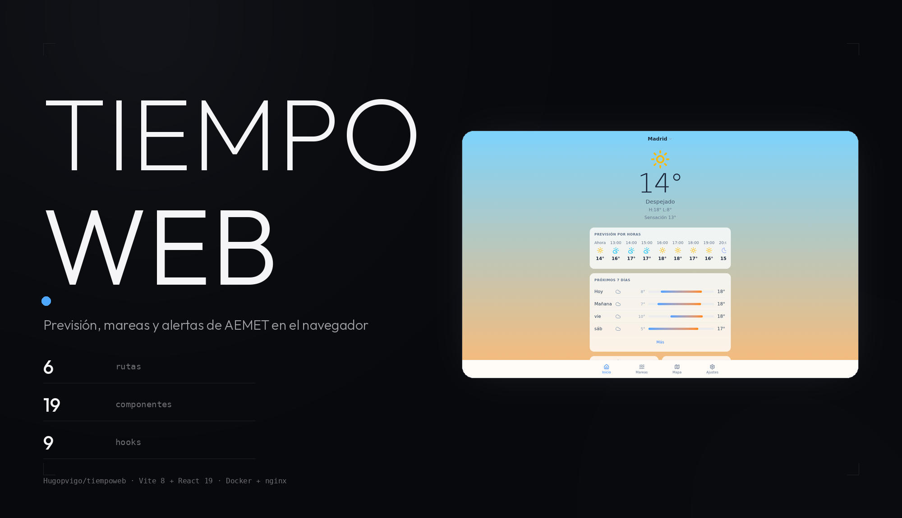
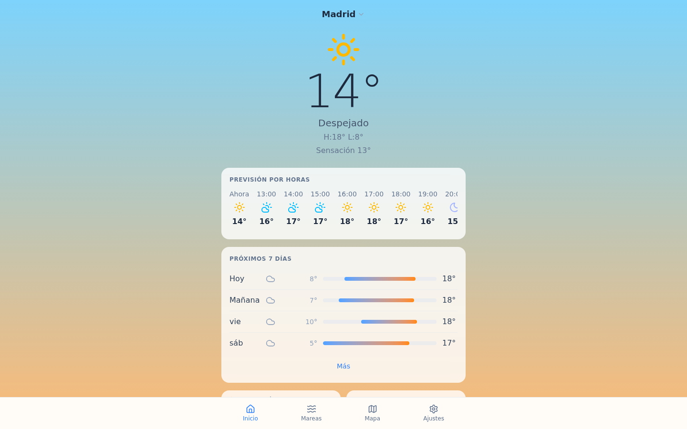

<meta property="og:title" content="TIEMPOWEB">
<meta property="og:description" content="El tiempo, las mareas y las alertas de AEMET en el navegador.">
<meta property="og:image" content="https://raw.githubusercontent.com/Hugopvigo/TiempoWeb/main/docs/capturas/og.png">

<p align="center">
  
</p>

<p align="center">
  <b>El tiempo, las mareas y las alertas de AEMET en el navegador.</b><br>
  Versión web de la app de meteorología: Vite, React y datos reales de Open-Meteo.
</p>

<p align="center">
  
  
  
  
  
</p>

---

## Qué es esto

Una SPA de meteorología con estética de fondo degradado y cristal, pensada
como versión web de la app de móvil. Tres piezas:

- **`shared/`**: el núcleo de la app nativa (React Native) portado a TypeScript
  sin dependencias de RN —tipos, constantes, servicios y utilidades— para
  que la web y el móvil compartan la misma lógica.
- **`web/`**: la aplicación de navegador con Vite 8 y React 19.
- **`docker/`**: el despliegue en contenedor, con nginx sirviendo el build.


*La pantalla de inicio con datos reales de Open-Meteo: temperatura, previsión
por horas y los próximos siete días.*

## Qué muestra

- **Previsión**: actual, por horas y a 7 días, con gráfico de probabilidad de
  lluvia.
- **Mareas**: horarios de pleamar y bajamar, con detección automática de si la
  ciudad es costera y gráfico sinusoidal.
- **Calidad del aire**: índice EAQI europeo y el detalle de PM2.5, PM10, O3 y
  NO2.
- **Fase lunar**: las 8 fases, con iluminación, orto, ocaso y la hora de
  amanecer y atardecer.
- **Mapa interactivo** (Leaflet) con cinco capas: radar, satélite, temperatura,
  viento y presión.
- **Alertas**: las oficiales de AEMET combinadas con las que se deducen de los
  propios datos, sin repetir.
- **Ciudades**: buscador con autocompletado, geolocalización y lista
  persistente en `localStorage`.
- **Tema** claro/oscuro con detección automática del sistema, y unidades de
  temperatura y viento configurables.

### De dónde salen los datos

| API | Qué trae | ¿Clave? |
|---|---|---|
| **Open-Meteo** | previsión, calidad del aire, datos marinos | no |
| **Open-Meteo Geocoding** | buscador de ciudades | no |
| **RainViewer** | radar de precipitación y satélite infrarrojo | no |
| **CARTO** | mapa base | no |
| **AEMET** | alertas oficiales en España | sí |
| **OpenWeatherMap** | capas de temperatura, viento y presión | sí |

Las claves se guardan en el store de ajustes (`openWeatherMapApiKey`,
`aemetApiKey`), pero **la versión web no tiene pantalla para introducirlas** y
`configureAEMET()` no llega a llamarse: tal como está, las alertas oficiales
de AEMET no llegan y las tres capas de OpenWeatherMap se quedan sin clave.
El resto funciona sin tocar nada.

## Desarrollo local

Monorepo con workspaces de npm: los comandos de la raíz se delegan en `web`.

```bash
npm install
npm run dev       # Vite en http://localhost:3000
npm run build     # tsc -b + vite build
npm run preview   # sirve el build
npm run lint      # eslint
```

### Con Docker

```bash
# producción: build + nginx en http://localhost:8080
docker compose -f docker/docker-compose.yml up app

# desarrollo: Vite con HMR en http://localhost:3000
docker compose -f docker/docker-compose.yml up dev
```

El `Dockerfile` es multi-stage: `node:20-alpine` compila y `nginx:alpine`
sirve `web/dist` con la SPA en fallback (`try_files … /index.html`), gzip y
cache de un año para los recursos con hash.

## Despliegue

El repo trae la receta de producción: el contenedor `app` publica el sitio en
`127.0.0.1:8080` y [`info.md`](info.md) documenta el VirtualHost de Apache
delante (proxy a ese puerto) con el SSL terminado en Cloudflare, preparado
para el subdominio `tiempo.hugoperezvigo.es`. El dominio anterior
(`tiempo.hugopvigo.es`) ya no resuelve: su DNS sigue en el parking de OVH,
apuntando a una IP sin servicio. En el servidor quedan los vhosts legacy que
redirigen (301) al dominio actual, por si vuelve a_publicarse el DNS.

```bash
cd docker
docker compose up -d app --build
docker compose ps
curl http://localhost:8080 | head
```

## Cómo está hecho

```
tiempoweb/
├── docs/capturas/            capturas de la web
├── shared/                  núcleo compartido con la app móvil
│   ├── constants/           gradientes, colores, mapeos WMO, zonas AEMET
│   ├── services/            Open-Meteo, AEMET, RainViewer, capas de mapa
│   ├── types/               tipos TypeScript
│   └── utils/               fase lunar, detección de ciudad costera
├── web/
│   └── src/
│       ├── components/      19 componentes: weather, tides, map, alerts…
│       ├── hooks/           9 hooks (TanStack Query + Zustand)
│       ├── routes/          6 rutas: Home, Search, Tides, Map, Settings…
│       └── stores/          Zustand + localStorage
└── docker/                  Dockerfile, Dockerfile.dev, compose y nginx
```

Stack: **Vite 8**, **React 19**, **TypeScript 6**, **Tailwind CSS 4** (plugin
de Vite, sin fichero de configuración), **React Router 7**, **TanStack Query 5**,
**Zustand 5**, **Leaflet** y **Lucide** para los iconos.

El historial de lo que se hizo por fases está en [`CHANGELOG.md`](CHANGELOG.md)
y el plan original en [`plan.md`](plan.md).

## Licencia

Bajo **CC BY-NC-SA 4.0**: compartir con atribución, sin uso comercial y bajo
la misma licencia. Consulta [LICENSE](LICENSE) para el texto completo.
